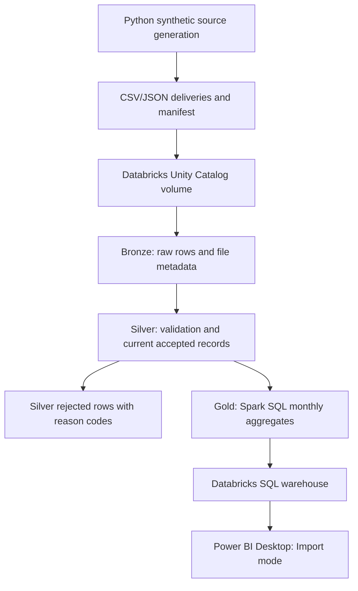
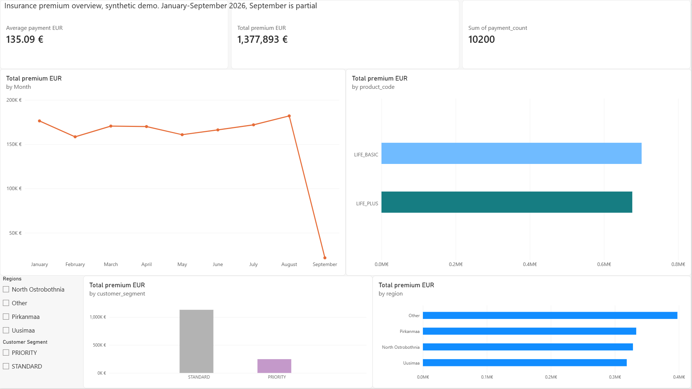
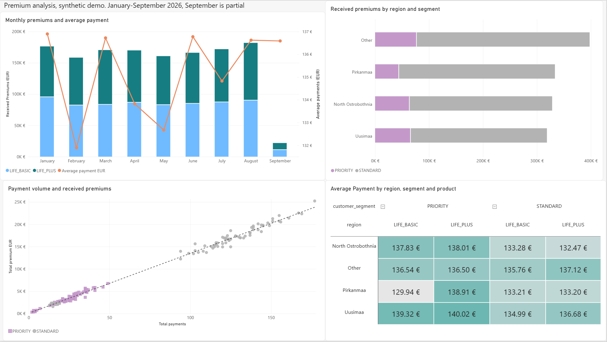

# Insurance Premium Data Pipeline

A small batch data engineering portfolio project that turns fictional customer,
policy and received premium exports into a two-page Power BI Desktop report.
Python generates the sources; cloud-hosted Databricks processes them through
Bronze, Silver and Gold Delta tables. Power BI imports the monthly Gold results
through a Databricks SQL warehouse.

The project demonstrates source validation, correction handling, replay checks
and reconciled reporting with simple insurance rules. Covers positive received
EUR payments and uses no real customer data or external insurance dataset.

## Architecture



The existing source volume is
`/Volumes/insurance_project/default/insurance_sources`. Source delivery and
notebook execution are manual.

## Synthetic sources

The default demo uses seed **42**, with **500 customers**, **1,000 policies** and
**10,000 initial payments**. Three payment deliveries introduce corrections,
duplicate versions, stale updates, late receipts and invalid rows. The final
accepted state contains **10,200 payments**.

A separate small fixture contains **14 payment batches** for specific processing
scenarios. These batches are distinct from the demo's **14 rejected update rows**.

Each source bundle has this layout:

```text
manifest.json                    # Delivery identities, UTC cutoffs, SHA-256 checksums, row counts
expected_outcomes.json           # Verification expectations only; not business input
reference/customers.csv
reference/policies.json
batches/<batch_id>/payments.csv
```

Generated demo files and source ZIP archives are gitignored. Detailed source
storage and extraction rules are in [source delivery documentation](docs/databricks_upload.md).

## Implemented features

- Reproducible Python source generation with a fixed seed and explicit scenarios.
- Manifest, checksum, structure, required-column, row-count and immutable
  delivery-identity validation.
- Bronze retention of raw row payloads, file status and source provenance;
  original file bytes remain in the volume.
- Silver value validation and checks against accepted customer/policy relationships.
  Rejected rows retain their payload, provenance and reason codes.
- Duplicate, correction, stale-version and late-payment handling, with one current
  accepted payment per payment ID. Invalid corrections preserve the accepted value;
  conflicting current or in-batch versions block that payment batch.
- Identical Bronze/Silver replays preserve stored records and audit timestamps.
- Spark SQL Gold aggregation with decimal amounts and reconciliation against
  Silver, followed by Power BI reporting from one small imported Gold table.

Detailed rules: [Bronze ingestion](docs/bronze_ingestion.md),
[Silver processing](docs/silver_processing.md) and [Gold reporting](docs/gold_reporting.md).

## Project structure

```text
insurance_demo/       Python generators and source-bundle helpers
data/fixtures/        Checked-in small scenario dataset and verification expectations
data/generated/       Generated demo deliveries and archive (gitignored)
databricks/           Five Databricks notebooks stored as .py source files
tests/                Standard-library unit tests
docs/                 Processing documentation and report screenshots
powerbi/              Native .pbip project, report and semantic model
.github/workflows/    Manually triggered local-test and notebook-syntax workflow
```

## Prerequisites

- Python **3.10+** and Git for local setup. Generation and local tests use only the
  Python standard library; no dependency installation or local Spark is required.
- Databricks with Unity Catalog volume access, notebook compute, Delta table
  read/write access and SQL warehouse access for reporting. The project uses
  Databricks Free Edition.
- Power BI Desktop for the report. Credentials and tokens remain outside Git and chat.

## Local setup

Reference checkout commands:

```powershell
git clone https://github.com/ltrieu22/insurance-data-pipeline.git
cd insurance-data-pipeline
```

Generation and test entry points, from the repository root:

```powershell
python -m insurance_demo.fixtures
python -m insurance_demo.generate
python -m unittest discover -s tests
```

Generation creates `data/fixtures/fixture_sources.zip` and
`data/generated/demo_sources.zip` alongside the extracted source files. Identical
existing files remain unchanged; different contents are refused. A changed
configuration requires a separate output directory. The
[GitHub Actions workflow](.github/workflows/tests.yml) runs only through
`workflow_dispatch`.

## Usage and configuration

### Source generation

`insurance_demo.generate` accepts:

| Option | Default | Meaning |
| --- | --- | --- |
| `--output` | `data/generated` | Output directory for demo sources and ZIP |
| `--seed` | `42` | Random seed |
| `--customers` | `500` | Initial customer count, at least 1 |
| `--policies` | `1000` | Initial policy count, at least 1 |
| `--payments` | `10000` | Initial payment count, at least 1 |

`insurance_demo.fixtures` accepts `--output`, defaulting to `data/fixtures`.
The reported verification results below apply to the default demo configuration.

### Databricks processing and reporting

Source ZIPs reside at `{volume_root}/{dataset}_sources.zip`; extracted deliveries
reside at `{volume_root}/{dataset}/`. Processing follows 00 → 01 → 02 → 04;
notebook 03 runs Bronze/Silver acceptance and replay checks.

| Notebook | Responsibility |
| --- | --- |
| [00_inspect_sources.py](databricks/00_inspect_sources.py) | Validate and extract the source archive; preview inputs |
| [01_ingest_bronze.py](databricks/01_ingest_bronze.py) | Store raw rows, file metadata and delivery identity |
| [02_transform_silver.py](databricks/02_transform_silver.py) | Validate references and payments; retain rejections and current records |
| [03_verify_pipeline.py](databricks/03_verify_pipeline.py) | Verify final state and identical Bronze/Silver replays |
| [04_build_gold.py](databricks/04_build_gold.py) | Refresh monthly Gold aggregates and reconcile with Silver |

| Notebook parameter | Values and behavior |
| --- | --- |
| `volume_root` | `/Volumes/<catalog>/<schema>/<volume>`; notebook 00 requires an explicit value; 01, 02 and 04 default to the existing source volume |
| `dataset` | `fixture` (default) or `demo`; selects source directory and table family |

Notebook 03 has explicit `fixture` arguments in its `%run` cells. For demo
verification, both called notebooks and the final acceptance dataset must select
`demo` consistently. Notebooks 01–03 share a workspace folder for relative `%run`
references. Table names derive from the volume's catalog/schema and selected dataset.

The [Power BI project](powerbi/insurance_premiums.pbip) imports
`insurance_project.default.insurance_demo_simple_gold_monthly_premiums` as
**Monthly premiums**. A different workspace requires its own SQL warehouse
connection and authentication. The Gold grain is one row per **payment month,
region, customer segment and product**. Its six columns are `payment_month`,
`region`, `customer_segment`, `product_code`, `payment_count` and
`total_premium_eur`. Month follows the payment receipt date.

## Verified results

The default demo passed Databricks final-state and identical Bronze/Silver replay
verification and Gold reconciled with Silver. Power BI Import was separately
checked for reporting groups, months, payment counts and premium totals.

| Metric | Verified default demo |
| --- | ---: |
| Accepted customers | 500 |
| Accepted policies | 1,000 |
| Current accepted payments | 10,200 |
| Rejected update rows | 14 |
| Gold reporting rows | 144 |
| Reporting months | 9: January–September 2026 |
| Received premiums | EUR 1,377,893.03 |
| Weighted average received payment | EUR 135.09 |

The last recorded pipeline verification passed all **51 local tests** and notebook
syntax checks. Local tests exercise Python processing helpers and Gold SQL through
SQLite adapters; Spark/Delta execution was verified separately in Databricks.

**September is partial:** 160 accepted payments total **EUR 21,854.23**, all dated
**2 September 2026**. The final declared delivery cutoff is **4 September 2026,
00:00 UTC**. September's chart values do not represent a full-month commercial decline.

## Power BI report

The saved [semantic model](powerbi/insurance_premiums.SemanticModel/definition/tables/Monthly%20premiums.tmdl)
contains these numeric measures:

```dax
Total premium EUR = SUM('Monthly premiums'[total_premium_eur])
Total payments = SUM('Monthly premiums'[payment_count])
Average payment EUR = DIVIDE([Total premium EUR], [Total payments])
```

Payment counts use `SUM(payment_count)`, not `COUNTROWS` of Gold. Average payment
is the ratio of summed premiums to summed payment counts in the current filter
context, so totals and matrix cells are weighted averages.



**Page 1 — overview.** Received-premium, accepted-payment and average-payment
cards; monthly premium trend; product, regional and segment totals; region and
customer-segment slicers. Scope: January–September 2026, with partial September.
The premium card displays a rounded EUR 1,377,893.



**Page 2 — analysis.** The report explores how payment volumes and average payment
amounts relate to received premiums across products, regions and customer
segments. In the unfiltered synthetic demo, both products contribute similar
premium totals, while STANDARD customers account for most received premiums.
Higher regional and segment totals coincide with more payments, with relatively
small differences in average payment size.

Overall, the pattern suggests that differences in premium totals mainly reflect
payment volume in this demo. September is partial, so its lower total should not
be interpreted as a full-month decline. Each scatter point represents a monthly
Gold reporting group. Matrix values are weighted averages.

## Limitations

- Small synthetic dataset and fictional business rules.
- Parsing and Silver validation run in driver-side Python. Silver recomputes the
  full delivery history; execution is sequential and separate table writes do
  not form one transaction.
- Customer/policy reference baselines are fixed; historical reference changes
  are outside the model.
- Gold uses a full refresh. Source delivery and notebook execution are manual.
- September partial coverage.
- Monthly Gold cannot provide distinct customer/policy counts, individual-payment
  distributions, unpaid premiums, claims, retention, or profitability.

## Possible future improvements

- Azure Data Lake Storage for source landing and Azure Data Factory for ingestion
  and orchestration.
- Alternatively, Amazon S3 for source storage and AWS Glue for processing.
- Automated delivery, scheduled jobs, monitoring and persisted run metrics.
- Distributed and incremental processing if larger data volumes justify it.

These are possible extensions, separate from the implemented pipeline.
